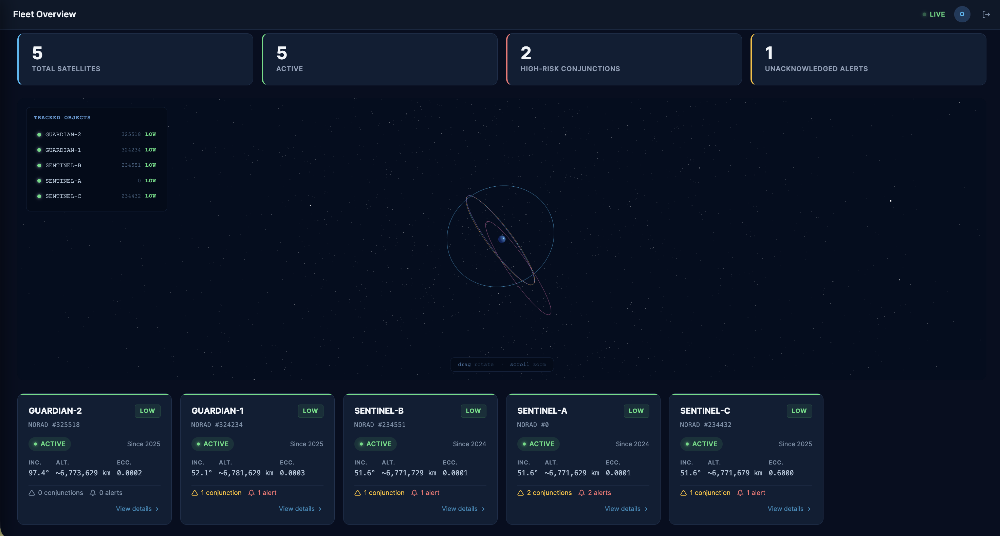
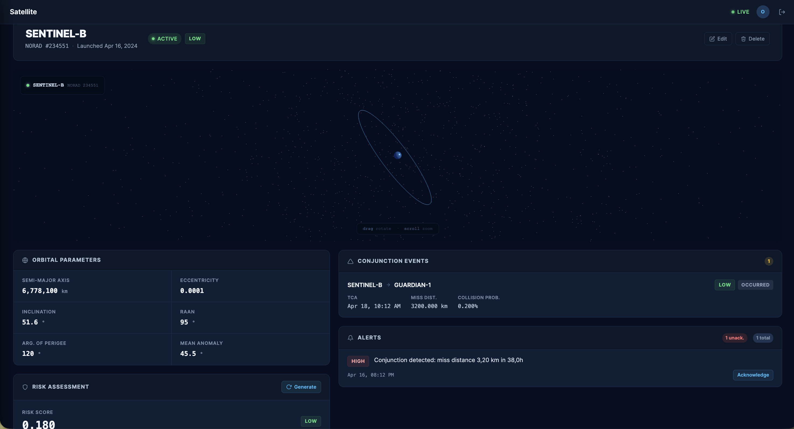

# SatSafe – Operator Front-End

Vue 3 front-end for [SatSafe](https://github.com/jevaali/satsafe), a space situational awareness platform. It gives satellite operators a live overview of their fleet, orbits, conjunction events and alerts.



## Features
- **Fleet overview:** fleet status, high-risk conjunctions and unacknowledged alerts at a glance
- **Interactive orbit view:** 3D visualisation of every tracked satellite's orbit (drag to rotate, scroll to zoom)
- **Satellite details:** orbital parameters, conjunction events with miss distance and collision probability, alerts that operators can acknowledge, and on-demand risk assessment
- **Fleet management:** add, edit and delete satellites
- **Operator settings:** organisation details, helper accounts, conjunction and alert thresholds, and action logs
- **Authentication:** JWT-based login with role-based access (operator / helper)



## Tech
Vue 3 · TypeScript · Pinia · Vue Router · Axios · Vite

## Structure
```
src/
├── api/                    # Axios setup and interceptors
├── services/api-services/  # API calls per feature
├── domain/                 # TypeScript models
├── stores/                 # Pinia stores (auth, satellites, ...)
├── views/                  # Pages
├── components/             # Reusable UI components
└── router/                 # Routes and auth guards
```

## Running locally
Requires Node.js and the [SatSafe backend](https://github.com/jevaali/satsafe) running.

```
npm install
npm run dev
```

Set the backend URL in `.env`
